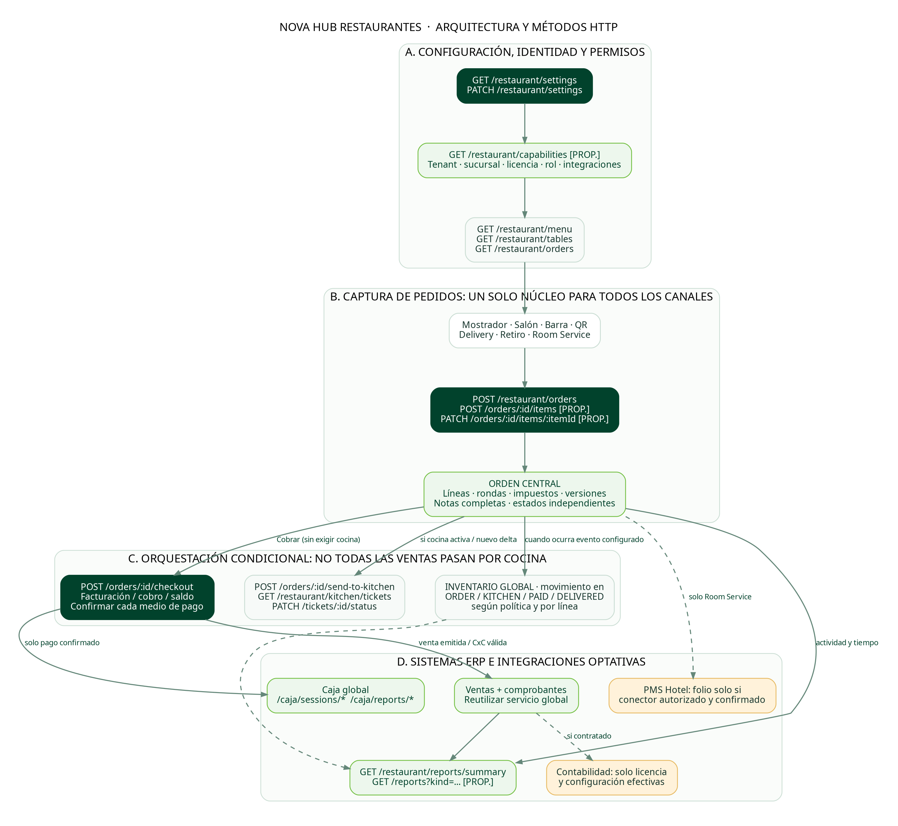
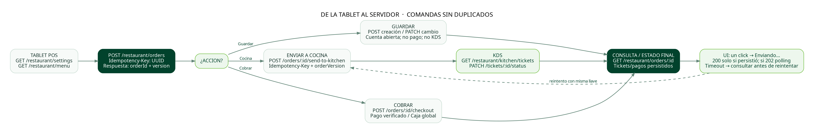
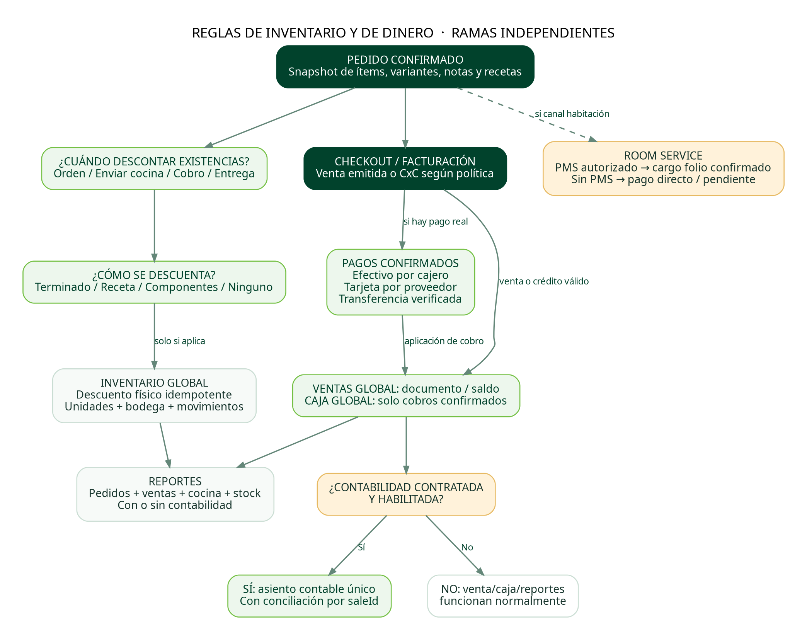
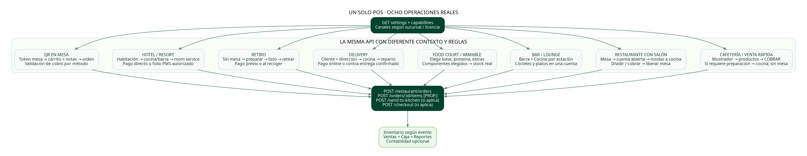

# NovaHub Restaurantes — Arquitectura de integración, contratos HTTP y plan de certificación

**Versión:** 1.0 — propuesta de arquitectura objetivo (no auditoría del repositorio).  
**Ámbito:** Restaurante POS, Salón, Pedidos, Cocina/KDS, Carta/QR, Delivery/Retiro, Room Service, Inventario global, Ventas, Caja, Reportes y Contabilidad opcional.  
**Fuentes:** diseño funcional acordado y análisis de Codex facilitado por el usuario. Las rutas citadas como *registradas en análisis* fueron identificadas por Codex, pero este documento **no certifica que estén implementadas o probadas**. **Todo contrato propuesto debe reconciliarse con el repositorio real.**

## 0. Condición para decir «100% listo»

No basta con que los botones estén presentes ni con recibir un HTTP 200. Exigir: (a) pruebas automatizadas de contrato, (b) integraciones reales e idempotentes, (c) transacciones trazables, (d) autorización por sucursal, (e) resultados iguales al operar desde dos tablets, (f) pruebas con 8 perfiles de restaurante, (g) cobros y stock conciliados, (h) monitoreo de errores, (i) plan de restauración/reintento. Contabilidad y PMS son opcionales y se deben probar tanto **habilitados** como **deshabilitados**.

## 1. Esquema de alto nivel



**Principio:** Todos los canales crean/actualizan una orden central. Una orden puede tener 0..N comandas (por rondas y estaciones), 0..N pagos (parciales/divididos), 0..N movimientos de existencias; los sistemas globales no deben duplicarse dentro del módulo Restaurante.

La orden posee ejes de estado **independientes**: `lifecycle` (DRAFT/OPEN/CLOSED/CANCELLED), `paymentStatus` (UNPAID/PARTIAL/PAID/REFUNDED), `preparationStatus` (NOT_REQUIRED/QUEUED/IN_PROGRESS/PARTIALLY_READY/READY), `fulfillmentStatus` (NOT_REQUIRED/PENDING/READY/OUT_FOR_DELIVERY/DELIVERED) y opcionalmente `tableState`. Cobrar antes de cocinar no debe cerrar la preparación ni cancelar una comanda.

## 2. Configuración y habilitaciones (GET/PATCH)

Al entrar a una sucursal:

1. `GET /restaurant/configuration?branchId=...` → perfil operativo, canales, Cocina, reglas de cobro, QR, `inventoryMode`, `deductInventoryAt`, bodegas y estaciones. En este repositorio `restaurant/settings` queda reservado para la presentación del menú público.
2. **Propuesta:** `GET /restaurant/capabilities?branchId=...` → capacidades efectivas derivadas de **licencia/suscripción**, **permisos**, **configuración de sucursal** y **conectores verificados**. Un switch visual no concede una licencia o permiso.
3. `GET /restaurant/menu`, `GET /restaurant/tables`, `GET /restaurant/orders`, `GET /restaurant/kitchen/tickets` según vistas y permisos. Evitar buscar datos innecesarios en cada cambio de pestaña.
4. `PATCH /restaurant/configuration` → guardar solo campos modificados y aplicar `version` / `If-Match` para conflictos. Debe retornar configuración persistida y `effectiveCapabilities`; los cambios deben quedar auditados.
5. Si `kitchenEnabled=false`, el POS vende sin KDS. Si `tableServiceEnabled=false`, el POS vende sin mesa. Si `allowQrOrders=false`, el menú público puede seguir en modo lectura. Si Contabilidad no está licenciada, las ventas/caja/reportes funcionan y no generan asientos automáticos.
6. Para Tarjeta Online: se muestra habilitada solo cuando la capacidad está incluida, el medio está configurado y el proveedor está conectado; no basta un interruptor en base de datos. Para Room Service con folio externo: exige conector PMS autorizado y verificado.
7. Moneda, impuestos globales, usuarios y sucursales se heredan del ERP; no replicar configuraciones independientes contradictorias.

**Configuraciones funcionales mínimas:** `operationProfile`, `enabledChannels`, `tableServiceEnabled`, `kitchenEnabled`, `inventoryMode` predeterminado, `deductInventoryAt`, `checkoutMode`, `allowQrOrders`, `allowTakeaway`, `allowDelivery`, `allowCustomerDisplay`, `allowRoomService` (**nuevo**), configuración de estaciones, lista de medios de pago, políticas de cuenta abierta, `stockPolicy`, `warehouseMapping`, `accountingEnabledEffective`, `pmsConnectedEffective`.

## 3. Tipos de entrada y responsabilidades

| Capa | Inputs | Validación obligatoria |
|---|---|---|
| UI / POS | `branchId`, `channel`, `tableId?`, `guestCount?`, `roomId?`, `customerId?`, productos, `variantId?`, `modifierOptionIds[]`, cantidades, notas, propinas/descuentos | Campos condicionales por canal; controles positivos; vista previa de impuestos y precios sin confiar en importes enviados por el navegador |
| API / comando | JWT/sesión, permiso, tenant, `idempotencyKey`, `expectedVersion`, esquema validado, `correlationId` | No permitir un cliente de una sucursal manipular IDs de otra; unicidad del comando; versionado optimista |
| Backend de dominio | configuración efectiva, reglas de cocina, receta/version, mapa de estación, bodega, impuestos y precios | Recalcular totales, stock, importe y descuentos en el servidor; guardar snapshot de líneas y modificadores |
| ERP global | `saleId`, pagos autorizados, movimientos de inventario, IVA/impuestos, sucursal, sesión de caja | Conciliación venta ↔ pagos ↔ caja; integridad del asiento solo si corresponde |
| Externos | referencia PMS/folio, `paymentProviderId`, webhook firmado | Permisos, firma, autenticidad, reintentos e idempotencia de callbacks |

**Significado de HTTP:** `GET` consulta, `POST` crea o ejecuta un comando, `PATCH` modifica parcialmente/cambia estado, `PUT` reemplaza recurso integral (p. ej. receta), `DELETE` elimina **solo si es seguro** (usar archivar/desactivar si tiene historia), `OPTIONS` es preflight CORS y **no equivale a una función de negocio**. UI inputs (select, radio, switch, texto, cantidad, checkbox) **no son métodos HTTP**: se convierten en payloads de GET/POST/PATCH/PUT.

## 4. Contratos API organizados por módulo

**Leyenda:** **A** = ruta listada o descrita en el análisis previo de Codex (método exacto debe cotejarse salvo indicación explícita); **P** = propuesta/extension pendiente de crear o confirmar. Usar `/restaurant` como prefijo orientativo; respetar convenciones existentes.

| Módulo | Método y ruta | A/P | Objetivo / body principal |
|---|---|---|---|
| Arranque | `GET /restaurant/configuration` | A | Reglas por sucursal (`branchId`) |
| Arranque | `PATCH /restaurant/configuration` | A | Cambios de perfil, canales, cocina, inventario, checkout |
| Arranque | `GET /restaurant/settings` | A | Presentación del menú público (tema, idioma e imágenes) |
| Arranque | `PATCH /restaurant/settings` | A | Cambios de presentación del menú público |
| Arranque | `GET /restaurant/capabilities` | A | Estado efectivo de licencia + permiso + conector |
| Carta | `GET /restaurant/menu` | A | Catálogo operativo y disponibilidad |
| Carta | `GET/POST /restaurant/menu/categories` | A ruta | Listar/crear categorías; confirmar verbo del backend |
| Carta | `GET/POST /restaurant/menu/items` | A ruta | Listar/crear platillos; verificar verbs |
| Carta | `GET/PATCH /restaurant/menu/items/:id` | A ruta | Obtener/modificar producto; no destruir ventas históricas |
| Carta | `GET /restaurant/menu/items/:id/recipe` | P | Leer receta/version y bodega |
| Carta | `PUT /restaurant/menu/items/:id/recipe` | P | Sustituir lista de ingredientes/cantidades/unidades/mermas |
| Carta | `GET /restaurant/menu/items/:id/cost` | P | Costo estimado calculado según insumos |
| Salón | `GET/POST /restaurant/tables` | A ruta | Listar/crear mesas, filtro `zone=all` o zona, estado |
| Salón | `GET/PATCH /restaurant/tables/:id` | A ruta | Consulta y edición; `409 TABLE_CODE_CONFLICT` con referencia visible |
| Salón | `POST /restaurant/tables/:id/qr/rotate` | P | Rotar token QR autorizado, sin romper ventas abiertas |
| QR público | `GET /restaurant/public/:tableToken/menu` | A ruta | Carta y mesa; lectura sin autorización de administrador |
| QR público | `POST /restaurant/public/:tableToken/orders` | A ruta | Crear solicitud QR; aplicar aprobación/pagos según política |
| Pedidos | `GET/POST /restaurant/orders` | A | Listar (filtros) / Crear `type`, referencia por canal, items, notas |
| Pedidos | `GET /restaurant/orders/:id` | A ruta | Ver detalle, rondas, saldos y estados ortogonales |
| Pedidos | `PATCH /restaurant/orders/:id/status` | A ruta | Cambios válidos de estado; servidor valida máquina de estados |
| Pedidos | `POST /restaurant/orders/:id/items` | P | Agregar ronda/ítems a cuenta abierta |
| Pedidos | `PATCH /restaurant/orders/:id/items/:itemId` | P | Editar delta con `expectedVersion` |
| Pedidos | `POST /restaurant/orders/:id/items/:itemId/cancel` | P | Cancelación con motivo, permisos y compensaciones |
| Pedidos | `POST /restaurant/orders/:id/split` | P | División: ítems/comensales/montos, conciliando saldos |
| Pedidos | `POST /restaurant/orders/:id/transfer` | P | Transferir a otra mesa o responsable |
| Pedidos | `POST /restaurant/orders/merge` | P | Unir cuentas con control de versiones y permisos |
| Pedidos | `POST /restaurant/orders/:id/reopen` | P | Reapertura autorizada, auditoría |
| Cocina | `POST /restaurant/orders/:id/send-to-kitchen` | A | Crear **solo nuevas líneas/rondas** por estación |
| Cocina | `GET /restaurant/kitchen/tickets` | A | Tickets activos por estación y estado |
| Cocina | `PATCH /restaurant/kitchen/tickets/:id/status` | A | Cambiar estado por ticket |
| Cocina | `PATCH /restaurant/kitchen/tickets/:id/items/:itemId/status` | P | Cambiar estado de línea, nota íntegra |
| Cocina | `POST /restaurant/orders/:id/resend-to-kitchen` | P | Reenvío **seguro** solo si no existe ticket equivalente |
| Cocina | `GET/POST /restaurant/stations`, `PATCH /restaurant/stations/:id` | P | Listar/crear/modificar estaciones según modelo real |
| Cobro | `POST /restaurant/orders/:id/checkout` | A | Total/mixto/propina, confirmación de efectivo o proveedor |
| Cobro | `GET /restaurant/orders/:id/payments` | P | Pagos y saldos por partes (o datos en GET pedido) |
| Delivery | `GET /restaurant/fulfillments` | P | Bandeja delivery, retiro, habitación |
| Delivery | `POST /restaurant/orders/:id/fulfillment` | P | Datos de entrega/retirada/habitación |
| Delivery | `PATCH /restaurant/fulfillments/:id/status` | P | PREPARING/READY/IN_ROUTE/DELIVERED, etc. |
| Reportes | `GET /restaurant/reports/summary` | A | KPIs básicos |
| Reportes | `GET /restaurant/reports?kind=sales|channels|preparation|tables|cancellations|food-cost` | P | Analítica detallada, agregados por tenant/sucursal |
| Caja | `/caja/sessions/*`, `/caja/reports/*` (métodos por verificar) | A | Reutilizar Caja global; verificar open/close/arqueo |
| Ventas, contabilidad, hotel | Rutas y servicios globales / conectores | P/verificar | No inventar rutas: descubrir contratos reales del repositorio |

**Observación:** una `POST /restaurant/orders/:id/checkout` con pagos mixtos puede requerir adaptar el contrato actual. No crear rutas alternativas paralelas sin antes revisar si la Caja global ya ofrece esa operación.

## 5. Diagrama de intercambio HTTP y confirmación real



**Ejemplo orientativo de creación** (nombres de enums/schemas deben conciliarse con el backend):

```http
POST /restaurant/orders
Authorization: Bearer <token>
Idempotency-Key: pos-branch-17-client-generated-uuid
Content-Type: application/json
```

```json
{
  "branchId": "BR001",
  "type": "DINE_IN",
  "tableId": "TABLE_03",
  "customerId": null,
  "guestCount": 4,
  "notes": "Una persona tiene alergia al maní",
  "sendToKitchen": false,
  "items": [
    {
      "itemId": "LATTE_12OZ",
      "quantity": 2,
      "variantId": "12OZ",
      "modifierOptionIds": ["MILK_OAT"],
      "note": "Uno sin azúcar"
    }
  ]
}
```

No enviar `total` o `unitPrice` como autoridad: el servidor debe calcular precios con un snapshot que preserve las condiciones originales de la venta. Para entrega a habitación, el canal `ROOM_SERVICE` y `roomId`/`folioId` son **extensiones propuestas**, no garantía de que el enum exista actualmente.

**Contrato mínimo de respuesta:** `orderId`, `orderVersion`, `status`, `paymentStatus`, `kitchenStatus`, `totals` calculados, `nextAllowedActions`, `correlationId` y, si se creó una comanda, `ticketIds`. Si hay procesamiento asíncrono, responder `202 ACCEPTED` + `operationId` y ofrecer una forma de consultar progreso. El frontend debe distinguir *comando recibido* de *comando terminado*.

**Errores estructurados recomendados:** `400 VALIDATION_ERROR`, `401 UNAUTHENTICATED`, `403 FORBIDDEN`, `404 NOT_FOUND`, `409 TABLE_CODE_CONFLICT`, `409 ORDER_VERSION_CONFLICT`, `409 ALREADY_PROCESSED`, `422 INVALID_TRANSITION`, `422 INSUFFICIENT_STOCK`, `503 PAYMENT_PROVIDER_UNAVAILABLE`; body con `code`, `message`, `correlationId`, `fieldErrors?`, `existingEntity?` según acceso. No filtrar datos entre tenants.

## 6. Eventos internos y garantías de una sola ejecución

Cada acción con efectos persistentes lleva `idempotencyKey`, `expectedVersion` cuando aplique y `correlationId` para trazabilidad. En una transacción, persistir cambio de estado de pedido y registro de evento **outbox**; publicar/reintentar con consumidores idempotentes. Alternativa equivalente permitida si el proyecto ya dispone de mecanismo confiable.

| Evento de dominio (nombres propuestos) | Productor | Consumidor(es) | Idempotencia / clave sugerida |
|---|---|---|---|
| `restaurant.order.created` | Orders | Pedidos, reportes | `orderId` |
| `restaurant.order.items.added` | Orders | KDS/inventario según política | `orderId + lineVersion` |
| `restaurant.kitchen.ticket.issued` | Orquestador cocina | KDS, impresora | `orderId + roundId + stationId + version` |
| `restaurant.kitchen.item.ready` | KDS | Pedidos, expedición, pantalla TV | `ticketItemId + transitionVersion` |
| `restaurant.inventory.consumption.required` | Orquestador policy | Inventario global | `orderItemId + eventPolicy + consumptionVersion` |
| `restaurant.payment.confirmed` | Caja/pasarela | Ventas, reportes, contabilidad optativa | `paymentProviderId` o `cashReceiptId` |
| `restaurant.sale.posted` | Ventas | Reportes y contabilidad si habilitada (venta o CxC, no cobro ficticio) | `saleId + postingVersion` |
| `restaurant.fulfillment.completed` | Entregas | Pedidos, reportes, política de inventario | `fulfillmentId + transitionVersion` |
| `restaurant.order.cancelled` | Orders | Cocina, inventario (si reversible), venta/caja | `orderId + cancellationId` |
| `restaurant.hotel.folio.charge.confirmed` | Adaptador PMS | CxC/folio e historial | `pmsTransactionId` |

Los callbacks o webhooks de tarjeta pueden llegar repetidos/fuera de orden; validar firma, importe, moneda, negocio, estado y correlación con intento de pago. No reconocer como cobrado por seleccionar “Tarjeta” ni por respuesta preliminar del navegador.

## 7. Descuento de existencias (no descuento de precio)



**Reglas de stock por producto:**
- `FINISHED`: descuenta 1 o `quantity` unidades del producto terminado.
- `RECIPE`: explode ingredientes según cantidades, unidades, sustituciones y merma; registrar insumos reales.
- `ASSEMBLED`: explotar únicamente componentes elegidos y sus recetas/subrecetas; no descontar componentes no seleccionados.
- `NONE`: no registra movimientos físicos. **Puede seguir registrando venta y margen solo si hay costo confiable.**

**Momento configurable** (elegir uno por política efectiva): `ORDER_CONFIRMED`, `SENT_TO_KITCHEN`, `PAYMENT_CONFIRMED` o `FULFILLMENT_COMPLETED`. Guardar borrador **nunca** debe descontar stock. Si se permite operar sin cocina, no seleccionar un evento inaccesible; advertir al configurar o utilizar un fallback explícito, auditado y probado, no silencioso.

**Precisión:** conversión de unidades (`kg↔g`, `L↔ml`), rendimiento de recetas, merma, bodegas por sucursal/estación, lotes/caducidad cuando aplique, disponibilidad con cambios de composición, stock negativo configurado. Enviar a cocina dos veces no debe descontar dos veces.

**Cancelación:** antes de preparar, restituir o liberar reserva según política; si el insumo ya se consumió, no aumentar ficticiamente existencias: registrar merma/pérdida o acción de devolución manual según permisos. Mantener costo, precio, IVA y descuento comercial independientes de movimientos físicos.

## 8. Cobro → Ventas → Caja → Reportes → Contabilidad (opcional)

1. POS muestra totales orientativos; servidor valida descuento comercial autorizado, impuestos, precio por variante y saldo pendiente. Separar los eventos `SALE_POSTED`, `PAYMENT_CONFIRMED` y `STOCK_MOVED`; pueden ocurrir en órdenes diferentes según canal.
2. Se crea intento de pago de efectivo, tarjeta, transferencia, mixto, parcial, o folio habitación. **El intento de efectivo no acredita dinero** hasta confirmación de cajero autorizado. Tarjeta necesita confirmación del procesador; transferencia requiere verificación conforme a política.
3. **Facturación y cobro son operaciones diferentes.** El checkout puede generar un documento de venta/factura según reglas fiscales incluso si el pago queda pendiente (cuenta por cobrar o cargo a habitación autorizado). Los **pagos efectivamente confirmados** se aplican a esa venta y a **Caja global**. Una cuenta dividida puede tener varios pagos; `sum(paymentsApplied) + saldoPendiente = totalFinal` (con redondeos controlados), y un mismo pago no se asigna dos veces. No registrar como ingreso de caja un crédito pendiente.
4. Los reportes operativos deben funcionar incluso si Contabilidad está desactivada. Ventas puede reconocer un documento/importe pendiente según su flujo fiscal; cobros solo reflejan dinero confirmado. La venta tiene ciclo de facturación/comprobante que debe concordar con las reglas fiscales del ERP.
5. Si el módulo Contabilidad está **licenciado y habilitado**, contabilizar la factura/venta y, por separado, los pagos y cuentas por cobrar que correspondan según la política fiscal y el régimen contable de la empresa. Nunca publicar un mismo asiento dos veces. Si no está habilitado, no bloquear checkout ni crear partidas ficticias.
6. **Hotel/Resort:** pedido `ROOM_SERVICE` contiene referencia habitación/huésped sin exponer datos no necesarios en KDS. **Cargo a folio PMS** solo si integrador está conectado, autorizado, y confirma cargo. Si no existe, permitir pago directo o registrar consumo pendiente (cuenta por cobrar correctamente tipificada) solo cuando el ERP lo soporte; no marcar como pagado ni como folio externo.
7. Las integraciones externas pueden fallar después de persistir la venta. Usar estado `PENDING_SYNC`/reintento y reconciliación; no borrar pedido. Las transacciones monetarias deben tener una fuente de verdad por pago.

## 9. Perfiles operativos y sus diferencias



| Escenario | Entrada / datos obligatorios | Preparación | Inventario | Cobro y cierre |
|---|---|---|---|---|
| Cafetería / venta rápida | `MOSTRADOR`, productos; sin mesa | Cobrar primero y enviar después si necesario; o entregar inmediato | Producto/receta por ítem | Cobro inmediato; puede haber orden pagada en preparación |
| Restaurante con salón | `DINE_IN`, `tableId`, `guestCount?` | Varias rondas y estaciones | Según receta/ítem | Cuenta abierta; dividir por comensal/producto/importe; liberar mesa tras cierre y entrega |
| Bar / lounge | `BAR` o `DINE_IN`; barra o mesa | Barra y cocina en paralelo | Recetas de bebidas y comida | Cuenta abierta o por ronda; propina opcional |
| Food court / bowl armable | `COUNTER` o `QR`, selecciones obligatorias | Enrutamiento por estación y preparación | Componentes realmente elegidos | Habitualmente pago primero; sin mesa |
| Delivery | `DELIVERY`, nombre/contacto/dirección/costo; cumplimiento | Cocina → empaquetado → en ruta | Según reglas | Online o contra entrega; no marcar cobrado antes de confirmación |
| Retiro | `TAKEAWAY`, cliente/retiro | Preparación → listo → retiro | Según reglas | Anticipado o al retirar |
| Hotel/resort | `ROOM_SERVICE`, habitación y permiso; PMS optional | Cocina/barra → despachar a habitación | Según reglas | Pago directo o cargo **confirmado** a folio externo; no simularlo |
| QR mesa | `tableToken`, ítems y notas completas | Aprobación opcional → tickets si corresponde | Según reglas | Efectivo solicitado o tarjeta integrada, con cuenta de la mesa |

## 10. Maquinas de estados y consistencia

### Orden
`DRAFT → OPEN → CLOSED`, `OPEN → CANCELLED` si no hay efectos incompatibles; extensiones para rectificación/reapertura auditada. Crear orden no supone enviar a cocina. Un pago confirmado puede ocurrir durante preparación.

### Ticket de cocina
`PENDING → PREPARING → READY → SERVED`, con `CANCELLED` solo por regla/permiso y manteniendo historial. Un ticket puede tener ítems con estados diferentes. Varias estaciones pueden completar en momentos distintos.

### Pago
`PENDING → AUTHORIZED → CAPTURED/CONFIRMED` o `FAILED/CANCELLED`; en efectivo existe confirmación humana; reembolso registra transacción compensatoria, no borra el cobro. Orden de estados no debe perder la distinción con delivery y mesa.

### Entrega
`PENDING → PREPARING → READY → IN_TRANSIT (si delivery) → DELIVERED`; retiro/habitación pueden saltar `IN_TRANSIT` según modelo. La habitación puede marcar `DELIVERED` sin que el cargo PMS esté confirmado, preservando cuentas pendientes.

### Seguridad de la autorización
Permisos por operación y sucursal, no solo ocultar botones. `POST /checkout`, `cancel`, `reopen`, `split`, `transfer`, `inventory.adjust`, `folio.charge` requieren verificación de autorización en servidor y registro de actor/correlación.

## 11. Validación obligatoria con el código real

### Paso 1 — inventario técnico (antes de modificar)
Para cada ruta de la tabla: encontrar controladores, servicios, DTO, validaciones, permisos, pruebas, registros DB, clientes frontend y eventos. Devolver tabla `RUTA | MÉTODO REAL | EXISTE | FRONTEND CONECTADO | TEST | GAP | PRIORIDAD`. Descubrir también contratos de caja, ventas, contabilidad, inventario, fiscalidad, QR y PMS. **No marcar CONNECTED si solo existe un método vacío o un mock.**

### Paso 2 — pruebas de contrato/integración
- Arranque en restaurante (GET settings/capabilities/menu/tables) y chequeo de pertenencia a tenant/sucursal.
- Crear pedido MOSTRADOR sin mesa; guardar/cobrar con y sin Cocina; pago confirmado enlaza Venta y Caja.
- Crear mesa W01 existente devuelve 409 con referencia segura; filtro Todas y archivadas.
- DOS tablets editan misma cuenta: `409 ORDER_VERSION_CONFLICT`, merge o reintento sin pérdida.
- Tres clics `Enviar a cocina` en latencia alta: una ronda por estación, un solo stock movement según evento.
- Enviar nueva ronda: solo nuevas líneas; tickets previos inmutables/auditables.
- QR con nota por pedido y por producto larga: conservada en DB, pedido, ticket, notificación y cocina.
- Ingredientes con kg↔g y L↔ml, variantes/sustituciones: cantidades exactas, sin doble débito.
- Inventario deshabilitado: venta sin movimientos; Cocina deshabilitada: venta sin error.
- Cobro parcial/mixto, cancelación y reembolso: saldo correcto, movimientos Caja y comprobantes vinculados.
- Proveedor de pagos: webhook repetido y timeout; cobro no duplica venta, caja ni asientos.
- Contabilidad ON y OFF; OFF nunca bloquea la venta; ON asiento correcto para venta/tasa y sin duplicar.
- Habitación: PMS conectado cobra folio una vez; desconectado no ofrece cargo automático.
- Reportes reflejan exactamente cobros/ventas/tiempos y cancelaciones, segregados por branch.
- Sin permisos, cada acción privilegiada devuelve 403 incluso invocando API directamente.

### Paso 3 — escenarios E2E para la matriz anterior
Implementar al menos 8 journeys E2E (uno por escenario) y repetir con combinaciones importantes: `kitchenEnabled` true/false, `inventoryMode` por ítem, `accountingEffective` true/false, permisos mesero/cajero/admin, y 2 sucursales. No necesita probar la totalidad de combinaciones cartesianas, pero sí pares de opciones y caminos críticos.

### Paso 4 — carga, estabilidad y recuperación
Simular múltiples terminales/tablets y múltiples comandas por minuto; reconexión Socket.IO y polling fallback; controlar el tiempo de respuesta del botón y de persistencia real; verificar recuperación tras reinicio/timeout con outbox/reconciliación; detectar pedidos/pagos/tickets atascados.

### Paso 5 — matriz de entrega verificable
Codex debe devolver **evidencia**, no solo un «terminado»: commit/PR, lista de rutas probadas, test outputs, capturas del E2E, fallos restantes, condiciones pendientes de servicios externos, incidencias clasificadas P0/P1/P2 y plano de despliegue/reversión.

## 12. Criterios mínimos de aceptación (P0/P1/P2)

**P0**: cada botón tiene feedback inmediato; caja vende sin mesa/cocina; no hay pagos ni comandas ni stock duplicados; autorización y aislamiento de sucursales; tarjeta no se marca pagada sin confirmación; Contabilidad OFF no bloquea; no se pierde una cuenta abierta ni notas.

**P1**: rondas, estaciones, parciales/división, cancelaciones, delivery/retiro, QR mesa, recetas y almacenes, room service pago directo, reportes por canal y sucursal, auditoría.

**P2 / conectores opcionales**: cobro online, PMS y cargo real a folio, contabilidad automática, sofisticación avanzada de inventario/mermas, pantalla TV, reconciliación con servicios externos y monitoreo configurable. Un producto puede considerarse apto para **un perfil limitado** mientras los extras no estén contratados, pero **no debe ofrecerse como completo para ese perfil si sus capacidades prometidas no están conectadas y probadas**.

## 13. Instrucción para Codex

> Audita el repositorio y concilia esta arquitectura objetivo con controladores, servicios, entidades y DTO reales. No inventes endpoints ni declares «100% conectado» sin ejecutar pruebas. Marca cada ruta como EXISTENTE, ADAPTAR o CREAR; aplica compatibilidad hacia atrás y protege idempotencia, transacciones y autorización. Devuelve un plan P0/P1/P2, implementa por vertical con tests y demuestra cada uno de los 8 escenarios en E2E. Mantén la misma identidad visual NovaHub y las acciones directas del POS. Reutiliza Caja, Ventas, Inventario y, solo si aplica, Contabilidad y PMS.
