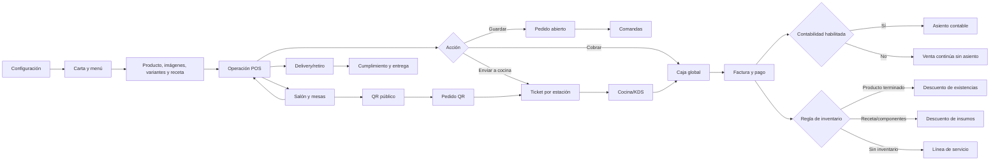

# Implementación Restaurante POS — vistas, navegación y endpoints

**Fecha de revisión:** 2026-10-13  
**Frontend:** `erp-novahub/novahub-frontend`  
**Backend:** `BackendERPNH`  
**Prefijo HTTP global:** `/api`

## 1. Criterio de validación

Este documento distingue tres niveles:

| Nivel | Significado |
|---|---|
| Implementado | La vista, contrato y lógica están presentes en el código revisado. |
| Validado en código | Compila y las pruebas focalizadas pasan, pero no implica que exista una base de datos desplegada con datos válidos. |
| Certificado en runtime | Requiere ejecutar la API con migraciones aplicadas, autenticación, tenant/sucursal, caja, bodega y datos reales. |

La revisión actual alcanza **implementado + validado en código**. No se debe presentar como certificación productiva al 100% mientras no se ejecute el checklist de runtime de la sección 9.

## 2. Vistas disponibles

La entrada principal está en `RestaurantePage.tsx` y expone estas vistas:

| Vista | Responsabilidad | Backend principal |
|---|---|---|
| Operación POS | Seleccionar canal, mesa, comensales, productos, variantes, notas, guardar, enviar a cocina y cobrar. | `restaurant/orders`, `restaurant/menu`, `restaurant/tables`, `restaurant/orders/:id/checkout` |
| Salón y mesas | Filtrar zonas, ver KPIs, abrir una mesa existente, crear mesa, ver QR y abrir POS. | `restaurant/tables`, `restaurant/tables/:id/qr/rotate` |
| Comandas | Consultar cuentas abiertas, canal, cliente/mesa, hora, productos, estado, total e historial. | `restaurant/orders`, `restaurant/orders/:id`, `restaurant/orders/:id/status`, `restaurant/orders/:id/send-to-kitchen` |
| Cocina | Ver tickets por estación y cambiar pendiente, preparación, listo o servido. | `restaurant/kitchen/tickets`, `restaurant/kitchen/tickets/:id/status` |
| Carta y menú | Categorías, productos, imágenes, galería, etiquetas, disponibilidad, variantes, recetas y publicación. | `restaurant/menu`, `restaurant/menu/categories`, `restaurant/menu/items`, `inventory/products/lookup` |
| Entrega y retiro | Filtrar delivery/retiro, dirección, referencia, repartidor y estado de cumplimiento. | `restaurant/orders?type=DELIVERY`, `restaurant/fulfillments`, `restaurant/orders/:id/delivery` |
| Reportes | Resumen operativo, ventas y platillos destacados. | `restaurant/reports/summary` |
| Configuración | Canales, cocina/KDS, inventario, cobros, permisos operativos y capacidades efectivas. El modo de habitación disponible en este repositorio es pago directo; el folio PMS queda bloqueado hasta conectar un adaptador. | `restaurant/configuration`, `restaurant/capabilities` |
| Menú público QR | Mostrar menú por mesa/token y recibir pedidos públicos idempotentes. | `restaurant/public/:tableToken/menu`, `restaurant/public/:tableToken/orders` |
| Room service | Menú público de una estancia y pedidos asociados a una reserva/enlace hotelero. | `hotel/public/:token/menu`, `hotel/public/:token/orders` |

## 3. Flujo de navegación

## 4. Contrato de configuración y capacidades

### Configuración

- `GET /api/restaurant/configuration?branchId=:branchId` (sin `branchId` usa la configuración del tenant)
- `PATCH /api/restaurant/configuration`
- `GET /api/restaurant/capabilities?branchId=:branchId`
- `GET /api/restaurant/settings`
- `PATCH /api/restaurant/settings`

La configuración es versionable y contiene, como mínimo:

- canales: salón, mostrador/retiro, delivery, QR y room service;
- cocina: habilitada, estaciones, envío automático/manual, KDS, impresión, alertas y tiempos;
- inventario: modo por defecto, bodega, momento de descuento, control de faltantes y devolución al cancelar;
- caja: efectivo, tarjeta, transferencia, QR, voucher, pago mixto, propinas, división y reapertura;
- contabilidad opcional;
- room service directo; `ROOM_CHARGE` y `PENDING_FOLIO` no se anuncian ni se confirman sin un adaptador PMS autorizado;
- permisos operativos.

La configuración operativa se guarda por sucursal cuando se envía `branchId`; si no existe un override de sucursal se hereda el JSON del tenant. El perfil comercial y los ajustes de presentación de la carta (`restaurant/settings`) siguen siendo globales del tenant. No son la misma ruta: `configuration` gobierna canales, cocina, inventario y cobros; `settings` gobierna tema, idioma e información de la carta pública.

`GET /api/restaurant/capabilities` devuelve qué capacidades están efectivamente disponibles para el tenant/sucursal, incluyendo bodega configurada, caja abierta, inventario, contabilidad y `pmsConnectedEffective=false` en el estado actual. La contabilidad efectiva usa `integrations.ACCOUNTING`; `cash.accountingEnabled` se conserva únicamente como compatibilidad de configuraciones antiguas.

## 5. Endpoints de Restaurante POS

### Salón, mesas y QR

| Método | Endpoint | Uso |
|---|---|---|
| GET | `/api/restaurant/tables` | Lista mesas filtrada por sucursal/zona/estado. |
| POST | `/api/restaurant/tables` | Crea una mesa con zona, código y capacidad. |
| PATCH | `/api/restaurant/tables/:id` | Actualiza estado, datos o asignación. |
| POST | `/api/restaurant/tables/:id/qr/rotate` | Rota el token QR de una mesa. |

### Carta, categorías y recetas

| Método | Endpoint | Uso |
|---|---|---|
| GET | `/api/restaurant/menu` | Carga categorías, productos, opciones y metadata de disponibilidad. |
| POST | `/api/restaurant/menu/categories` | Crea categoría. |
| PATCH | `/api/restaurant/menu/categories/:id` | Edita, ordena u oculta categoría. |
| POST | `/api/restaurant/menu/items` | Crea platillo. |
| PATCH | `/api/restaurant/menu/items/:id` | Edita platillo, imágenes, publicación y metadata. |
| GET | `/api/restaurant/menu/items/:id/recipe` | Obtiene modo de inventario y líneas de receta. |
| PUT | `/api/restaurant/menu/items/:id/recipe` | Guarda producto terminado, receta, componentes, variante y bodega. |
| GET | `/api/restaurant/menu/items/:id/cost` | Calcula costo del platillo a partir de la receta. |
| GET | `/api/inventory/products/lookup` | Fuente de productos y variantes para vincular carta con inventario. |

Los modos soportados son `FINISHED_PRODUCT`, `RECIPE`, `COMPONENTS`, `ASSEMBLED` y `NONE`. `NONE` representa explícitamente una venta de servicio sin descuento de inventario.

### Pedidos, comandas y estados

| Método | Endpoint | Uso |
|---|---|---|
| GET | `/api/restaurant/orders` | Lista pedidos; acepta sucursal y tipo de pedido. |
| GET | `/api/restaurant/orders/:id` | Detalle, productos, eventos y mesa. |
| GET | `/api/restaurant/orders/:id/payments` | Pagos asociados al pedido/factura. |
| POST | `/api/restaurant/orders` | Crea cuenta/pedido desde POS o flujo público. |
| POST | `/api/restaurant/orders/:id/items` | Agrega una ronda a una cuenta abierta. |
| PATCH | `/api/restaurant/orders/:id/status` | Cambia estado comercial del pedido. |
| POST | `/api/restaurant/orders/:id/send-to-kitchen` | Genera comanda/ticket por estación. |
| PATCH | `/api/restaurant/orders/:id/delivery` | Actualiza dirección, repartidor y estado de entrega. |
| GET | `/api/restaurant/fulfillments` | Lista cumplimientos de delivery/retiro/room service. |
| POST | `/api/restaurant/orders/:id/checkout` | Emite factura y registra el cobro en Caja. |
| POST | `/api/restaurant/orders/:id/payments` | Registra abonos posteriores sobre una factura parcial y actualiza el saldo de la comanda. |

Tipos de pedido soportados por backend: `DINE_IN`, `COUNTER`, `TAKEAWAY`, `DELIVERY`, `QR` y `ROOM_SERVICE`.

### Cocina/KDS

| Método | Endpoint | Uso |
|---|---|---|
| GET | `/api/restaurant/kitchen/tickets` | Tickets pendientes, en preparación, listos o servidos. |
| PATCH | `/api/restaurant/kitchen/tickets/:id/status` | Actualiza estado, timestamps y estado agregado del pedido; acepta `Idempotency-Key`. |

Las etiquetas operativas se presentan en español: `Pendiente`, `En preparación`, `Listo` y `Servido`. El backend conserva estados técnicos como `IN_PREPARATION`.

### Reportes

- `GET /api/restaurant/reports/summary`

Entrega resumen operativo, ventas, pedidos por estado/canal y platillos destacados según sucursal y rango de fechas.

## 6. Canales públicos y hotel

### QR de mesa

- `GET /api/restaurant/public/:tableToken/menu`
- `POST /api/restaurant/public/:tableToken/orders`
- `GET /api/restaurant/public/:tableToken/orders/:id`

El POST público debe llevar una clave de idempotencia. El backend resuelve la mesa por token, valida disponibilidad/canal, crea el pedido y genera cocina si la configuración del canal lo indica.

### Habitación / room service

- `GET /api/hotel/public/:token/menu`
- `POST /api/hotel/public/:token/orders`
- `GET /api/hotel/room-types`
- `GET /api/hotel/rooms`
- `GET /api/hotel/availability`
- `GET /api/hotel/reservations`
- `GET /api/hotel/reservations/:id`
- `POST /api/hotel/reservations`
- `PATCH /api/hotel/reservations/:id`
- `POST /api/hotel/reservations/:id/check-in`
- `POST /api/hotel/reservations/:id/check-out`
- `POST /api/hotel/reservations/:id/cancel`
- `POST /api/hotel/reservations/:id/no-show`
- `POST /api/hotel/reservations/:id/guest-link`
- `POST /api/hotel/reservations/:id/guest-link/revoke`

El pedido de room service directo está implementado y exige token de estadía válido. `ROOM_CHARGE` y `PENDING_FOLIO` se rechazan explícitamente porque este repositorio no contiene un adaptador PMS/folio: no se puede registrar un cargo externo ficticio.

## 7. Integración con Caja, Inventario y Contabilidad

### Caja y cobro

El checkout de restaurante delega en Caja; no duplica la lógica de factura. Endpoints relacionados:

- `GET /api/caja/registers`
- `GET /api/caja/registers/status`
- `POST /api/caja/sessions/open`
- `GET /api/caja/sessions/active/:registerId`
- `POST /api/caja/invoices`
- `POST /api/caja/invoices/check-duplicates`
- `GET /api/caja/invoice-cash-queue`
- `PATCH /api/caja/invoice-cash-queue/:id/claim`
- `PATCH /api/caja/invoice-cash-queue/:id/pay`
- `POST /api/caja/sessions/:id/movement`
- `POST /api/caja/sessions/:id/close`

Medios alineados: `CASH`, `CARD`, `TRANSFER`, `CHECK`, `QR`, `VOUCHER` y `CUSTOMER_BALANCE` donde Caja lo permita. QR, voucher, transferencia, tarjeta y cheque requieren referencia según las reglas del método.

El cobro aplica:

1. validación de tenant, sucursal, caja y sesión abierta;
2. validación de método, cuenta contable y referencia;
3. validación de producto, variante y bodega cuando corresponde;
4. factura, líneas, pagos y movimientos en una transacción;
5. evento de pedido cobrado e idempotencia;
6. asiento contable si `integrations.ACCOUNTING` está activo; si está desactivado, la venta y los pagos continúan sin generar asiento.

### Inventario

Endpoints de apoyo:

- `GET /api/inventory/products/lookup`
- `GET /api/inventory/warehouses`
- `GET /api/inventory/warehouses/catalog`
- `GET /api/inventory/stock`
- `GET /api/inventory/stock/:warehouseId`
- `POST /api/inventory/stock/update`
- `GET /api/inventory/movements`
- `POST /api/inventory/movements`
- `GET /api/inventory/products/:productId/variants`
- `POST /api/inventory/products/:productId/variants`

El flujo de restaurante registra eventos idempotentes de inventario y descuenta según `ORDER_CREATED`, `SENT_TO_KITCHEN`, `PAID` o `DELIVERED`. La configuración global define la política por defecto y el `deductWhen` guardado en cada platillo se respeta como override efectivo. Si un pedido no puede alcanzar el evento configurado (por ejemplo, una venta directa sin envío a cocina o un pedido no entregable con `DELIVERED`), el backend usa explícitamente `PAID` como evento terminal para no dejar stock sin movimiento. Para receta/componentes, cada línea debe quedar vinculada a un producto de inventario. Para `NONE`, el checkout envía una línea de servicio y no descuenta existencias.

### Contabilidad

La contabilidad no se ejecuta como una pantalla aislada del restaurante: se dispara desde Caja cuando `integrations.ACCOUNTING` está activo. La venta continúa sin asiento cuando está desactivada, conforme al diagrama funcional; esto aplica tanto al checkout inicial como a los abonos posteriores. Para certificarla se necesitan cuentas de ingreso, IVA, inventario, costo, caja/banco y bodega configuradas.

## 8. Reglas de consistencia implementadas

- **Idempotencia:** creación de pedido, rondas, envío a cocina, checkout y movimientos de inventario usan clave idempotente o evento deduplicable.
- **Mutaciones operativas:** cambios de estado comercial, fulfillment y tickets KDS también aceptan `Idempotency-Key`; el frontend usa `api.idempotentPatch`.
- **Concurrencia:** los cambios de pedido aceptan `expectedVersion`; un conflicto devuelve `ORDER_VERSION_CONFLICT` en vez de sobrescribir una modificación concurrente.
- **Respuesta de comandos:** creación, rondas, estados, fulfillment, checkout y abonos conservan los campos legados y agregan `orderId`, `orderVersion`, `paymentStatus`, `kitchenStatus`, `totals`, `nextAllowedActions`, `correlationId` y `ticketIds`.
- **Ámbito:** las consultas y mutaciones validan `clientTenantId`, sucursal y permisos del usuario.
- **Cocina:** enviar a cocina crea tickets por estación; el pedido avanza cuando sus tickets avanzan.
- **Cobro independiente de preparación:** el checkout puede cobrar una orden confirmada, enviada o en preparación; `paymentStatus`/`lifecycle` se actualizan sin cerrar `preparationStatus`, y una orden ya pagada todavía puede enviarse a cocina.
- **Lectura de estados en UI:** POS, Salón, Comandas y Entrega usan los ejes independientes; una orden pagada permanece visible mientras cocina o fulfillment siga abierto, sin habilitar un segundo cobro ni agregar rondas a una orden cerrada.
- **Cierre después del cobro:** enviar a cocina conserva `PAID` cuando el cobro ocurrió antes de la preparación; el ticket puede completar su ciclo y delivery cierra el lifecycle al marcarse `DELIVERED`.
- **Delivery/retiro:** el estado de fulfillment queda separado del estado comercial del pedido.
- **Inventario:** una misma deducción no se repite; cancelación puede devolver existencias según configuración.
- **Cobro:** la factura, los pagos, la caja y el asiento se procesan en la ruta de Caja correspondiente.
- **Recetas:** `PUT /menu/items/:id/recipe` persiste modo, producto terminado, variante, bodega y líneas validadas contra el tenant.
- **Momento de inventario:** la configuración global (`configuration.inventory.deductWhen`) es el fallback; el `deductWhen` del platillo se normaliza y se aplica por línea, sin duplicar movimientos. Cuando el canal no alcanza el evento elegido, se resuelve a `PAID` de forma explícita.
- **Configuración por sucursal:** `Branch.restaurantConfiguration` sobrescribe el JSON del tenant para operación; la pantalla de configuración envía y lee `branchId`, y capacidades, checkout, pedidos, cocina y fulfillment consultan la configuración efectiva de la sucursal.
- **Contabilidad opcional:** el toggle de Integraciones y el checkout comparten `integrations.ACCOUNTING`; los pagos parciales posteriores también respetan esa bandera al pasar por `CajaService`/`SalesService`.
- **Estados independientes:** `RestaurantOrder` persiste `lifecycle`, `paymentStatus`, `preparationStatus`, `fulfillmentStatus` y `tableState` además del enum comercial legado y `deliveryStatus`. La migración `20261013110000_add_restaurant_order_state_axes` rellena los pedidos existentes y las transiciones mantienen ambos contratos.

## 9. Matriz de escenarios a certificar en runtime

| Escenario | Código revisado | Requiere runtime antes de declararlo listo |
|---|---:|---:|
| Configurar canal salón/mostrador/delivery/QR | Sí | Guardar y volver a leer configuración con tenant real |
| Configuración operativa por sucursal y fallback al tenant | Sí | Aplicar migración `20261013120000_add_branch_restaurant_configuration` y comparar dos sucursales |
| Cocina desactivada | Sí | Crear pedido y verificar que no aparezca ticket |
| Cocina manual/automática | Sí | Confirmar envío y ticket por estación |
| Pedido con mesa y comensales | Sí | Mesa, pedido y estado ocupado en BD |
| Pedido de mostrador/retiro | Sí | Crear fulfillment y cambiar estados |
| Pedido delivery | Sí | Dirección, repartidor, ruta y entrega |
| Pedido QR público | Sí | Token válido, idempotencia y pedido público |
| Room service directo | Sí | Token hotelero y reserva válida |
| Room service a folio | Bloqueado explícitamente | Requiere implementar y verificar un adaptador PMS/webhook autorizado antes de habilitarlo |
| Producto terminado | Sí | Producto, variante, bodega y stock real |
| Receta/componentes | Sí | Líneas vinculadas, stock y costo en BD |
| Venta sin inventario (`NONE`) | Sí | Confirmar que factura como servicio y no mueve stock |
| Inventario por pedido/cocina/pago/entrega | Sí | Verificar movimiento, cantidad, override por platillo, fallback `PAID` y deduplicación |
| Pago efectivo/tarjeta/transferencia/QR/voucher | Sí | Caja abierta, cuentas y referencias configuradas |
| Pago mixto | Sí | Métodos activos y desglose real |
| Pago parcial | Sí | Caja abierta, cliente con crédito/límite y fecha de vencimiento en BD real |
| Contabilidad activada | Sí | Activar `integrations.ACCOUNTING`, validar mapeos contables y asiento balanceado en BD real |
| Contabilidad desactivada | Sí | Venta exitosa sin asiento contable |
| Reintento de checkout | Sí | Misma idempotency key y una sola factura |
| Dos operadores editando pedido | Sí | Conflicto de versión controlado |

### Pagos parciales implementados

`POST /api/restaurant/orders/:id/checkout` puede crear una factura `PARTIAL` cuando la política lo permite, exige cliente y vencimiento, registra únicamente el importe efectivamente recibido y deja la comanda en `PARTIALLY_PAID`. Los abonos posteriores entran por `POST /api/restaurant/orders/:id/payments`, reutilizan `SalesService.createMixedPayment`, actualizan factura/saldo/Caja/contabilidad y cierran la comanda solamente cuando el saldo llega a cero. La validación final requiere datos reales de crédito, Caja y cuentas.

## 10. Evidencia ejecutada en esta revisión

### Backend

- `npx prisma validate` — **pasó**.
- `npx prisma generate` — **pasó previamente**.
- `npm run build` — **pasó después de la migración de ejes y el orquestador por línea**, `Successfully compiled: 506 files with swc`.
- `npm test -- --runInBand src/restaurant/restaurant.service.spec.ts src/caja/caja.service.spec.ts src/common/payment-methods.spec.ts` — **pasó**, 3 suites y 27 pruebas.
- `node e2e/scripts/verify-backend-surfaces.mjs` — **pasó**, 62 controllers y 1324 rutas clasificadas; esta verificación es estática y no sustituye un runtime.

### Frontend

- `npm run build` — **pasó**, Vite transformó 5404 módulos y generó `dist`.
- El build conserva advertencias de chunks grandes y de `html2canvas`; no bloquean compilación.
- No se ejecutó E2E automatizado en esta revisión, conforme a la solicitud.

### Auditoría de deriva frente al contrato arquitectónico

El contrato técnico contiene además extensiones propuestas (`P`) que no son necesarias para el flujo POS operativo actual y no deben confundirse con endpoints activos: edición/cancelación de ítem individual, dividir/transferir/combinar/reabrir una cuenta, estado de cocina por ítem, reenvío de comanda, CRUD de estaciones, reportes detallados y algunos endpoints de fulfillment alternativos. No se anuncian como implementados en esta entrega. El flujo activo usa las rutas listadas en las secciones 4–7.

El catálogo y branding de carta permanecen tenant-scoped; la configuración operativa de canales, cocina, inventario y cobros sí admite override por sucursal. El room service a folio PMS continúa bloqueado explícitamente porque no existe el adaptador externo ni su webhook de confirmación.

## 11. Gates necesarios para afirmar “100% funcional”

Antes de producción se debe ejecutar con una base de datos de prueba del tenant:

1. aplicar `20261012100000_complete_restaurant_pos_contract`, `20261013110000_add_restaurant_order_state_axes`, `20261013120000_add_branch_restaurant_configuration` y las migraciones previas en orden;
2. crear sucursal, mesa, caja abierta, sesión de caja, bodega, productos, variantes, lista de precios y cuentas contables;
3. probar cada fila de la matriz de escenarios;
4. verificar en BD factura, pago, movimientos, eventos, tickets, fulfillment, saldo y asiento;
5. verificar reintentos idempotentes y conflicto de versión;
6. probar permisos por rol y aislamiento entre tenant/sucursal;
7. mantener room service a folio deshabilitado hasta implementar y probar el adaptador PMS/webhook;
8. confirmar migraciones, variables de entorno, despliegue y logs del ambiente objetivo.

Hasta completar esos gates, el estado correcto es **funcional en código y validado por compilación/pruebas focalizadas; pendiente de certificación runtime/deployment**, no “100% productivo”.

## 12. Archivos clave revisados

- `BackendERPNH/src/restaurant/restaurant.controller.ts`
- `BackendERPNH/src/restaurant/restaurant-public.controller.ts`
- `BackendERPNH/src/restaurant/restaurant.service.ts`
- `BackendERPNH/src/caja/caja.controller.ts`
- `BackendERPNH/src/caja/caja.service.ts`
- `BackendERPNH/src/inventory/inventory.controller.ts`
- `BackendERPNH/prisma/schema.prisma`
- `erp-novahub/novahub-frontend/src/app/components/RestaurantePage.tsx`
- `erp-novahub/novahub-frontend/src/app/components/restaurant/RestaurantConfigurationPage.tsx`
- `erp-novahub/novahub-frontend/src/app/components/restaurant/RestaurantMenuWorkspace.tsx`
- `erp-novahub/novahub-frontend/src/app/services/restaurant.service.ts`
