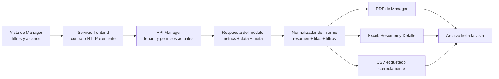

# Diseño: corrección de resúmenes y exportaciones de Manager

**Fecha:** 2026-10-14
**Estado:** Especificación para revisión; todavía no implementada.

## Objetivo

Corregir los resúmenes y las exportaciones disponibles en las vistas de Manager para que el PDF, Excel y CSV representen los datos que corresponden a la vista, sus filtros y su alcance. La revisión abarcará cada vista y acción de exportación que ofrece Manager, incluyendo el resumen global, los módulos consolidados y la vista de ajustes de inventario.

## Evidencia revisada

- La captura compartida muestra el PDF de **Resumen de ventas** con cinco tarjetas de KPI sin texto y una tabla con “Sin registros para el alcance seleccionado”.
- En `ManagerSalesModule.tsx`, la exportación de la vista `overview` convierte `report.data` en filas. El backend construye el overview de ventas con `data` vacío y las métricas en `metrics`; por eso el exportador recibe filas vacías aunque sí haya indicadores.
- `managerSalesExport.ts` usa la plantilla configurable `reportes.sales`. Esa plantilla define nodos fijos para cinco KPI; el exportador actual no entrega esas tarjetas desde `metrics`, lo que explica los rectángulos vacíos de la captura.
- Los módulos consolidados comparten contratos que reciben filtros, `report`, `export`, `page` y `pageSize`. Varias exportaciones solicitan una sola página grande y procesan `data` como si fueran todas las filas.
- `ManagerInventoryAdjustmentsView.tsx` solicita hasta 5.000 ajustes en una exportación y su opción PDF imprime la vista que está renderizada. Eso no garantiza incluir todos los resultados filtrados.
- `ManagerPurchasesModule.tsx` y otros módulos usan `generateManagerTablePDF`; el formato compartido actual no comunica de forma consistente filtros, sucursal/unidad, resumen de métricas y paginación.
- Los contratos HTTP consolidados ya existen en `enterprise-groups.service.ts` del frontend y en el controlador/servicio de `enterprise-groups` del backend. El problema observado está en cómo se interpretan y presentan las respuestas de resumen y detalle.

## Alcance

Se auditarán y corregirán las acciones visibles de resumen/exportación para:

1. Resumen global de Manager.
2. Inventario, incluidos sus reportes y ajustes.
3. Ventas.
4. Compras.
5. Finanzas.
6. Contabilidad.
7. Reportes consolidados.
8. Recursos Humanos.
9. Operaciones y sus submódulos con exportación disponible.

La lista concreta de vistas se obtendrá de las definiciones actuales `MANAGER_*_VIEWS` y `MANAGER_OPERATION_DEFINITIONS`, y se cotejará con cada botón, menú y handler de exportación. No se dará por cubierta una vista solo porque su módulo tenga una exportación genérica.

Se revisarán las exportaciones de informes y listados. Las facturas, cotizaciones y demás documentos transaccionales conservan sus plantillas propias; solo entrarán en cambios si la auditoría confirma que la misma falla de datos afecta también esas acciones.

## Diseño funcional

### Resúmenes

- El resumen se construirá desde `metrics` y otros agregados explícitos de la respuesta. No se tratará `data` como origen de KPI.
- Cada indicador exportado tendrá etiqueta y valor, con formato de moneda, cantidad, fecha y porcentaje acorde con su tipo.
- Se incluirá una tabla de detalle solo cuando la respuesta realmente contenga filas de detalle. El resumen no mostrará una tabla vacía como si eso invalidara los KPI.
- Si no hay registros ni indicadores para el alcance, el archivo mostrará un mensaje explícito de ausencia de datos. Nunca se dibujarán tarjetas de KPI vacías.
- Los desgloses por sucursal/unidad solo se agregarán cuando el contrato provea esos datos.

### Detalle, filtros y alcance

- Se conservarán en la solicitud los filtros activos de la vista: búsqueda, fechas, estado, tipo y filtros propios del módulo.
- La exportación identificará el grupo/empresa y los alcances disponibles: unidad de negocio, sucursal, bodega/almacén y moneda o modo de valoración cuando aplique.
- Los informes de detalle incluirán todos los resultados filtrados, no solo la página visible ni una primera página de hasta 5.000 filas.
- Se utilizará la paginación del contrato hasta completar `meta.totalPages` o su equivalente. Si un endpoint no puede entregar la totalidad por una limitación del backend, se corregirá el endpoint existente para soportar el reporte completo y mantener los mismos filtros y permisos.
- Un error o una descarga incompleta no se presentará como exportación exitosa.

### Formatos

- **PDF:** salida de informe de Manager con título, nombre de empresa/grupo, alcance, filtros, periodo, fecha de generación, KPI disponibles y detalle cuando exista. Las tablas llevarán encabezados legibles y número de página.
- **Excel (.xlsx):** hoja `Resumen` con alcance, filtros y KPI; hoja de detalle solo cuando haya filas. Columnas con títulos, tipos y formatos útiles para revisión.
- **CSV:** cuando la acción produzca CSV, su etiqueta y extensión dirán CSV. No se anunciará Excel si se descarga CSV.
- La exportación PDF de ajustes de inventario incluirá el conjunto completo de ajustes filtrados y no dependerá de las filas que estén actualmente montadas en pantalla.

## Arquitectura propuesta

Se reutilizarán los servicios HTTP y la infraestructura de PDF/Excel existentes. Los componentes de Manager pasarán una respuesta normalizada —alcance, filtros, métricas y filas completas— a exportadores compartidos o a adaptadores por módulo cuando las columnas de dominio sean distintas.

## Endpoints y contratos

Se reutilizarán las rutas existentes:

- `GET /enterprise-groups/manager/:groupId/overview`
- `GET /enterprise-groups/manager/:groupId/inventory/module`
- `GET /enterprise-groups/manager/:groupId/sales/module`
- `GET /enterprise-groups/manager/:groupId/purchases/module`
- `GET /enterprise-groups/manager/:groupId/finance/module`
- `GET /enterprise-groups/manager/:groupId/accounting/module`
- `GET /enterprise-groups/manager/:groupId/reports/module`
- `GET /enterprise-groups/manager/:groupId/hr/module`
- `GET /enterprise-groups/manager/:groupId/operations/module`
- El contrato existente de ajustes de inventario, llamado por `getAdjustments`.

No se propone crear rutas nuevas, modificar el esquema Prisma ni agregar migraciones. Si el trabajo de implementación comprueba que un contrato existente no puede entregar todas las filas bajo los filtros autorizados, la solución se mantendrá dentro del endpoint existente siempre que sea suficiente y segura. Los permisos de lectura/exportación y el aislamiento por tenant/sucursal seguirán siendo los que aplica actualmente Manager.

## Fuera de alcance

- Cambiar reglas de negocio, cálculos contables, datos persistidos o estados transaccionales.
- Cambiar permisos, membresías, aislamiento de tenant o el alcance de sucursales.
- Rediseñar las pantallas de Manager fuera de etiquetas de formato necesarias para que la descarga no prometa un archivo distinto.
- Cambiar plantillas de documentos transaccionales que no estén afectadas por el defecto auditado.
- Cambiar endpoints públicos o introducir una nueva API de exportación.

## Criterios de aceptación

- El PDF de Resumen de ventas ya no presenta tarjetas vacías; los indicadores coinciden con `metrics` del contrato para los mismos filtros y alcance.
- En todas las vistas de Manager, cada acción de exportación representa su propio tipo de datos y columnas, y no reutiliza accidentalmente columnas o plantilla de otro módulo.
- Un resumen con KPI válidos aparece aunque `data` esté vacío; un detalle sin filas no oculta un resumen válido.
- Una vista realmente vacía informa que no hay datos sin mostrar KPI en blanco ni filas ficticias.
- Los filtros, fechas, grupo, unidad, sucursal, bodega/almacén y moneda aplicables se conservan en el archivo y en la consulta.
- Las exportaciones de detalle contienen todas las páginas filtradas disponibles según el contrato y no se limitan silenciosamente a la página visible o a 5.000 filas.
- El PDF de ajustes incluye todos los ajustes filtrados.
- Las extensiones, nombres de archivo y etiquetas coinciden con el formato descargado.
- La exportación conserva autorización, tenant y alcance existentes.
- Los cambios se verifican con build del frontend y, si se toca el backend, build y comprobaciones relacionadas. La revisión visual del PDF/Excel se reportará aparte de esas comprobaciones.

## Evidencia por reportar al implementar

Se entregará una matriz por módulo/vista/acción con: endpoint usado, filtros enviados, fuente del resumen, columnas, formato, paginación aplicada y resultado de la revisión visual. Se distinguirán los hallazgos estáticos, los builds y la comprobación manual de archivos para no presentar una cosa como evidencia de otra.
